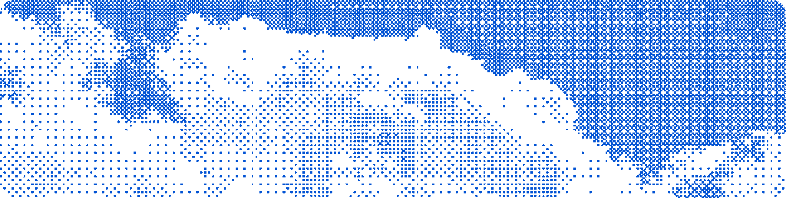
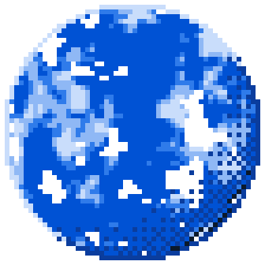
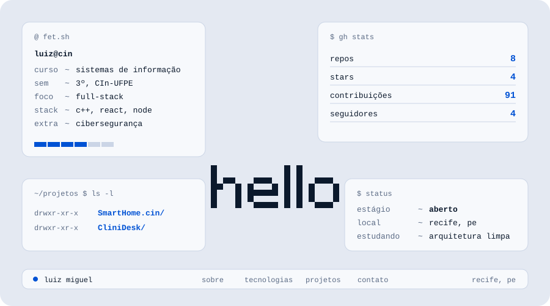

  

 

<table>
  <tr>
    <td width="30%" align="center" valign="middle">
      
    </td>
    <td width="70%" valign="middle">
      <h2>Sobre mim</h2>
      
Oi, eu sou o <b>Luiz Miguel</b>. Estudo Sistemas de Informação no <b>CIn-UFPE</b> (3º semestre) e gosto de construir software que resolve problemas reais do dia a dia.

      
Meu foco é <b>desenvolvimento full-stack</b>, com interesse em <b>cibersegurança</b>, <b>engenharia de software</b> e <b>automação com IA</b>. Trabalho com C++, React, Node.js, Python e Docker, e estou sempre estudando arquitetura limpa e segurança web para entregar aplicações seguras e escaláveis.

      
Estou em busca de <b>estágio</b>.

    </td>
  </tr>
</table>

 

  

 

<h2 align="center">Tecnologias</h2>

  
  
  
  
  
  
  
  

 

<h2 align="center">Projetos em destaque</h2>

<table>
  <tr>
    <td width="50%" valign="top">
      <h3><a href="https://github.com/emfs2-byte/EDOO_Project">SmartHome.cin</a></h3>
      
Projeto de automação residencial desenvolvido na disciplina de orientação a objetos.

      
      
    </td>
    <td width="50%" valign="top">
      <h3><a href="https://github.com/emfs2-byte/D.S-Project">CliniDesk</a></h3>
      
Sistema de gestão para clínicas, com foco em organização de atendimentos.

      
      
    </td>
  </tr>
</table>

 

<h2 align="center">Contato</h2>

  
  
  

  

